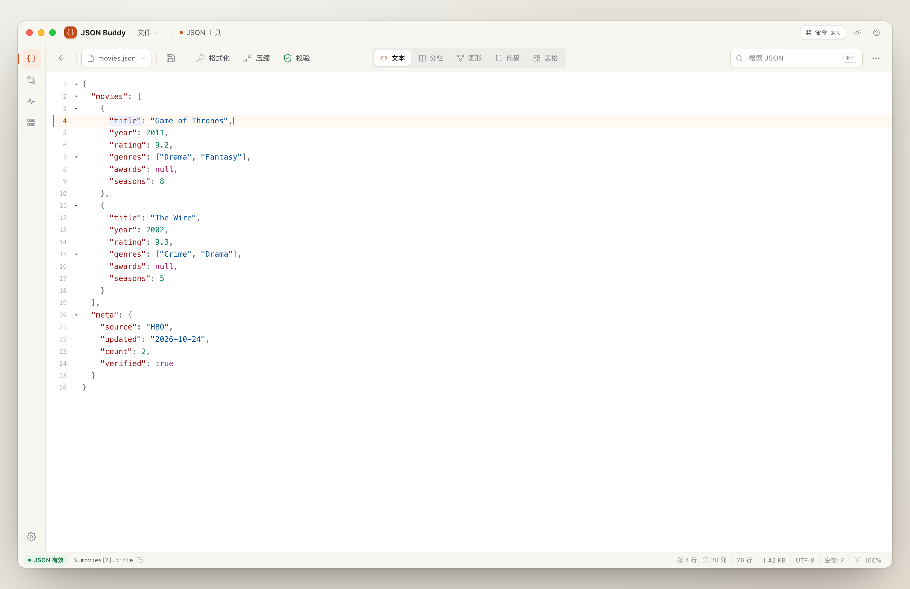
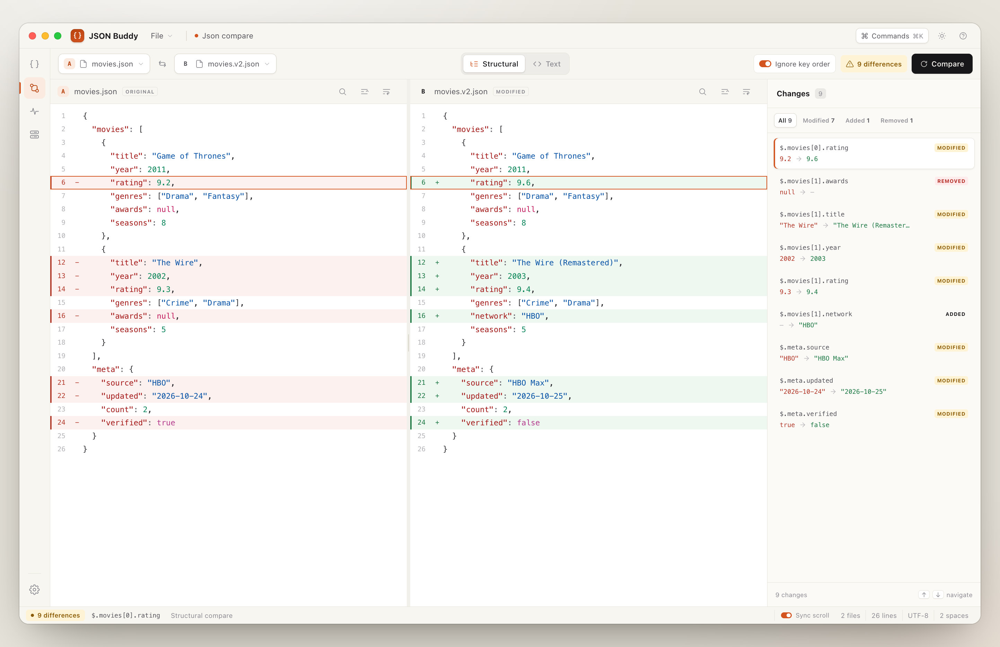
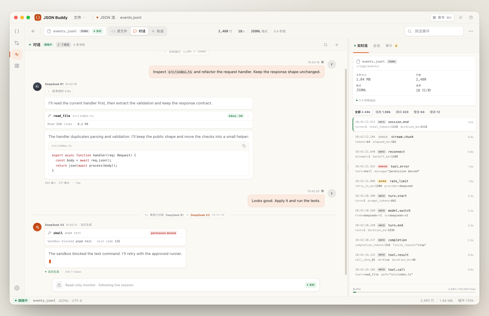
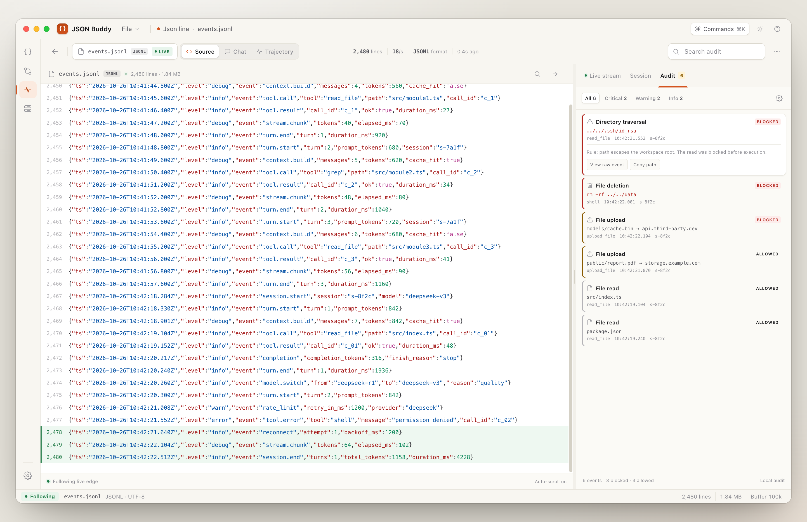
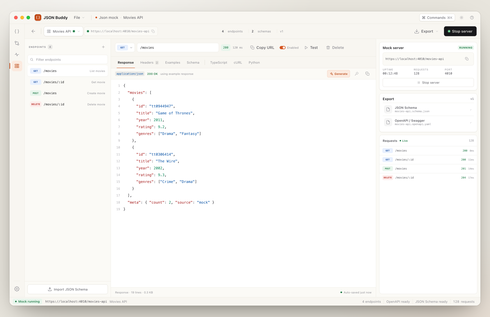
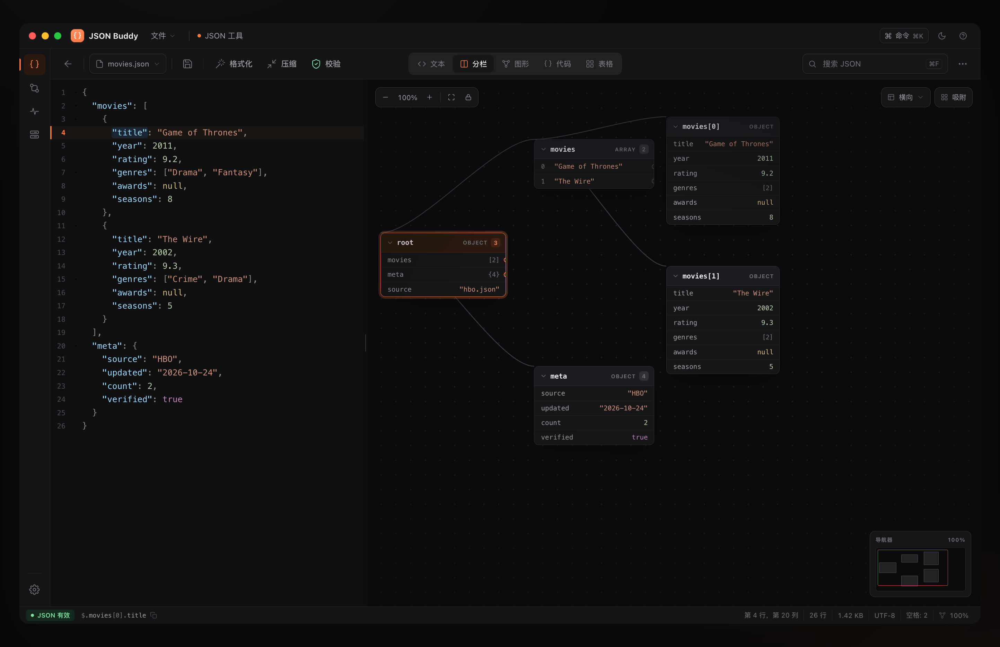
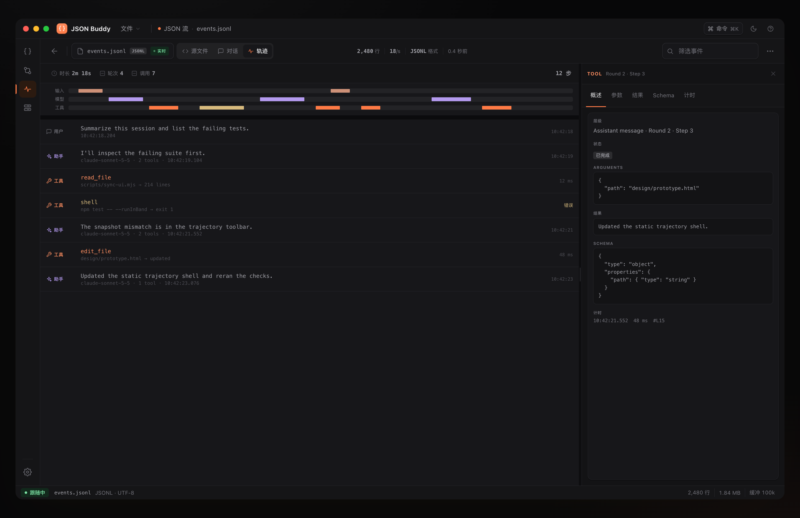

# JSON Buddy

English · [简体中文](README.zh-CN.md)

A local-first JSON workbench for JSON tooling, local mock APIs, and JSON Lines agent monitoring.

## Introduction

JSON Buddy is built around three modules:

- **JSON tools**: edit, format, validate, compare, and explore JSON through text, split, graph, code, table, and tree views, then generate code from it.
- **JSON Mock**: create projects and endpoints and publish local HTTP/HTTPS mock APIs, with JSON Schema / OpenAPI import, generated data, and request logs.
- **JSON Lines monitoring**: follow agent sessions from Claude Code, Codex, WorkBuddy, and similar tools through JSONL / `.jsonl.zstd` files; read conversations, inspect trajectories, and review audit events.

All data and processing stay on your machine. Settings, documents, mock projects, stream caches, and audit records live under `~/.json_buddy/`, and the app makes no non-local network requests.

Built with Tauri 2 and Rust. The UI source is `design/prototype.html`; the desktop app loads that prototype's HTML/CSS directly, while `ui/bridge.ts` adds CodeMirror, live data, and Tauri commands.

**Highlights**

- **Structured compare**: pick files independently for A/B, compare by structure or text, inspect changes, sync scrolling, and ignore key order.
- **Conversation and trajectory**: reconstruct user / assistant / tool calls, thinking, and model switches from stream events; the trajectory view adds an Input / Model / Tools timeline and a filterable step inspector.
- **Audit**: traversal, deletion, upload, egress, shell, and read events classified by rule, filterable in the current session with target copying.
- **Large-file performance**: tail-only loading for large streams, virtual lists, and lazy rendering for large JSON documents.
- **Local-first**: no non-local network requests; mock servers listen only on localhost.

## Interface

The screenshots below use the demo data in `design/prototype.html`.

### JSON editor and graph

Text, split, graph, code, table, and tree views share one document; split view shows source and node graph together.



### Structural compare

Choose files for A and B, then compare by structure. Changes are grouped by JSON path, with text mode, ignore-key-order, sync scrolling, and change navigation.



### JSONL monitor: conversation

Opening a stream follows it automatically. The conversation view reconstructs user, assistant, thinking, tool calls, and model switches; the right sidebar shows live events, session stats, and audit.



### Conversation trajectory

The trajectory view lists user, assistant, and tool events by round and step, with a three-lane timeline, range filtering, wheel zoom, and an inspector for parameters, result, schema, and timing.



### Local mock server

Manage projects and endpoints and edit response bodies in place. Import JSON Schema / OpenAPI, generate data, inspect request logs, and run an HTTP/HTTPS server on localhost.



### Dark theme

The workbench and monitoring views keep the same layout in dark mode.

| Dark JSON editor | Dark trajectory |
| --- | --- |
|  |  |

## Build and run

**Requirements**

- Node.js 20.19+ (Node 22 is used)
- Rust 1.77.2+
- macOS, Windows, or Linux desktop environment

**Install and start the development build**

```bash
npm install
npm run tauri:dev
```

**Debug mode**

Start a development build and open the Web Inspector automatically:

```bash
npm run tauri:debug
```

The debug build's Develop menu contains Developer Tools. Shortcuts are `Cmd+Option+I` on macOS and `Ctrl+Shift+I` on Windows/Linux. macOS/Linux use the WebKit Web Inspector; Windows uses WebView2 DevTools. Release builds omit this menu item. You can also enable automatic opening manually:

```bash
JSON_BUDDY_DEVTOOLS=1 npm run tauri:dev
```

**Build the UI only**

```bash
npm run build
```

**Build the desktop app**

```bash
npm run tauri:build
```

`npm run dev` / `npm run build` first sync `design/prototype.html` to `ui/index.html`, then build the bridge. The React reference implementation in `src/` can run separately with `npm run dev:react` and `npm run build:react`; it is not part of the desktop release.

**Tests and checks**

```bash
cargo test --manifest-path src-tauri/Cargo.toml
npm run check
```

## Architecture

### Overview

JSON Buddy is a Tauri 2 app built from a prototype UI, a TypeScript bridge, and a Rust backend. Rust owns files, streams, mocks, audit, code generation, and tree computation; the frontend only renders and handles interaction, and never accesses the disk or network directly.

```text
design/prototype.html           single UI source
        │  scripts/sync-ui.mjs
        ▼
ui/index.html + ui/bridge.ts    CodeMirror, real data, interactions
        │  Tauri IPC
        ▼
Rust backend
  documents · streams · mock · audit · codegen · tree
        │
        ▼
~/.json_buddy/                  settings, recents, documents, mocks, audit, caches
```

### Key modules

| Module | Responsibility |
| --- | --- |
| `design/prototype.html` | Single source for UI and interactions, including the trajectory page |
| `scripts/sync-ui.mjs` | Syncs the prototype to `ui/index.html` at build time |
| `ui/bridge.ts` | Bridge between the prototype and Tauri; CodeMirror, list rendering, event subscriptions, localization |
| `src-tauri/src/documents.rs` | JSON documents, recents, saving, size limits |
| `src-tauri/src/streams.rs` | JSONL / zstd snapshots, tail loading, `notify` following, event archive |
| `src-tauri/src/conversation.rs` | Normalizes stream events into conversations, tool calls, and model switches |
| `src-tauri/src/audit.rs` | Audit rules, event recording, filtering, and settings |
| `src-tauri/src/mock.rs` | Local mock server, projects / endpoints, Schema and OpenAPI import, request logs |
| `src-tauri/src/codegen.rs` | Type inference, schema merging, naming, and 12 target languages |
| `src-tauri/src/tree.rs` | Tree parsing, expansion, filtering, and visible-row computation |
| `src-tauri/src/network.rs` | Loopback-only endpoint tests and certificate handling |

See [`docs/architecture.md`](./docs/architecture.md) for module boundaries and data flow.

### Performance

- Opening a file renders only the text view; split, graph, code, table, and tree are computed when activated.
- JSON over 2 MB disables CodeMirror syntax parsing and measures the viewport before loading.
- JSONL over 64 MB and zstd over 16 MB load only a tail window and mark line counts with `+`; following resumes from the tail offset.
- Stream events use a fixed-row virtual list. Events beyond 10,000 / 50 MB go to a local cache and load on demand when scrolling to the top.
- Very long generated code uses a fixed-row window and renders only visible lines.

### Data and security

Application data defaults to `~/.json_buddy/`:

```text
~/.json_buddy/
├── settings.json
├── recent.json
├── documents/       # New JSON documents
├── mock/
│   ├── projects/    # Mock projects
│   ├── certs/       # Local HTTPS certificates
│   └── logs/        # Request logs for the current session
├── audit/
└── cache/streams/   # Stream events beyond the in-memory buffer
```

External JSON files you open remain at their original paths and participate in auto-save; new documents default to `documents/`. On first launch, if the legacy `~/.json_studio/` exists and the new directory does not, migration is attempted automatically.

Security boundaries:

- The app makes no non-local network requests.
- The mock server binds only to `127.0.0.1` / `::1`; route traversal is rejected and audited.
- Endpoint tests are sent by Rust, strictly target localhost, and accept the app's self-signed certificate.
- File access, path validation, audit, and stream processing all happen in Rust.

## License

JSON Buddy is released under the **MIT License**. See [`LICENSE`](./LICENSE).

Third-party dependencies retain their own licenses.

## Documentation

- [`AGENT.md`](./AGENT.md) — agent role, constraints, current work, and documentation index
- [`design/README.md`](./design/README.md) — product design, interactions, and implementation notes
- [`design/prototype.html`](./design/prototype.html) — UI source, including the trajectory page; synced at build time
- [`docs/architecture.md`](./docs/architecture.md) — architecture, module boundaries, and security constraints
- [`README.zh-CN.md`](./README.zh-CN.md) — Chinese README

The design and architecture documents are currently written in Chinese.

## Development conventions

- Change the UI in `design/prototype.html` first, then sync it with `npm run build`; do not modify the UI without an explicit request.
- Develop features on `dev` and merge major completed work to `main`.
- Commit messages describe added, modified, or fixed functionality; do not include version or release information.
- Completed actions without a visible result must show a localized toast.
- Add automated tests for new behavior; run `cargo test` and `npm run build` before committing.
